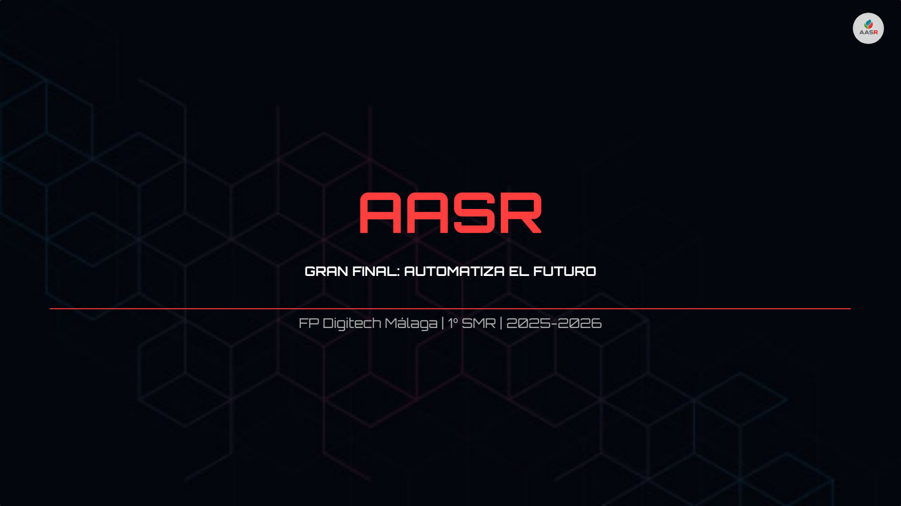
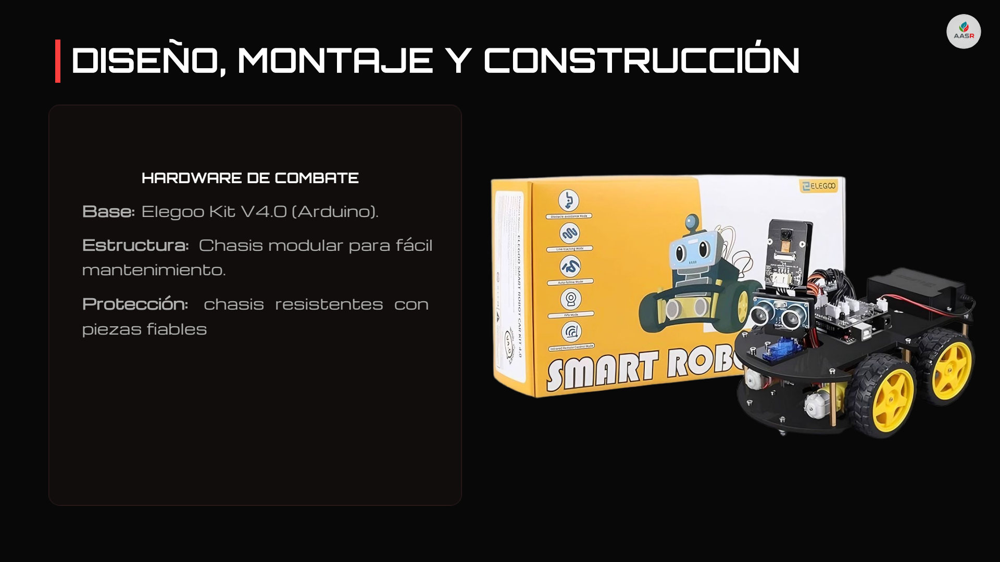
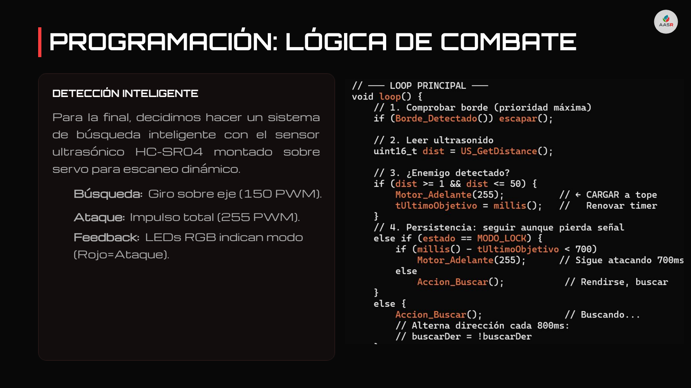
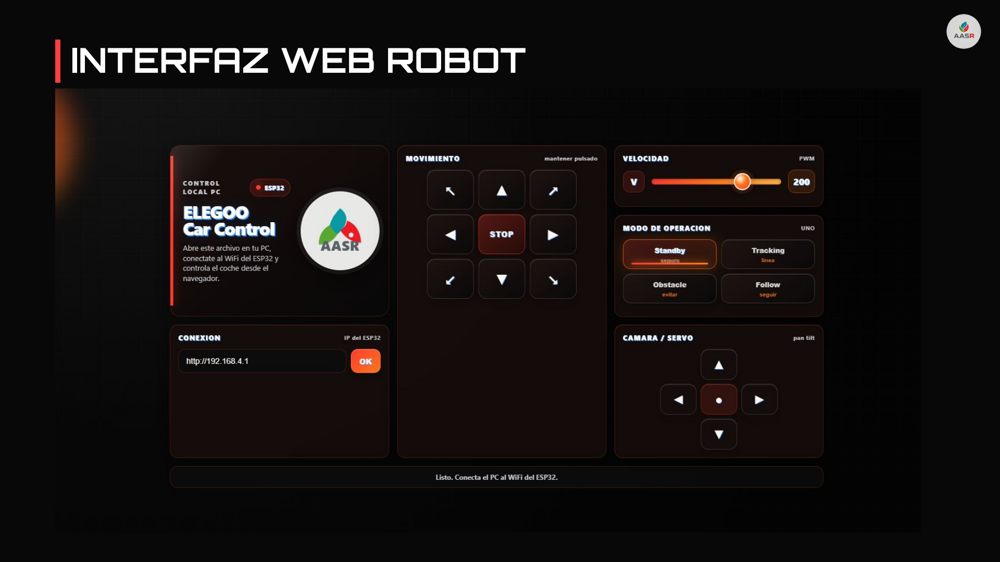

# 🤖 AASR — ASTI Robotics Challenge 2026

Robot de competición del equipo **Avería Andante Sin Reparo (AASR)**, de **Digitech Málaga** (1.º SMR, curso 2025/26), **finalista del ASTI Robotics Challenge 2026**: la mayor competición de robótica educativa de España, organizada por la **Fundación ASTI**.

📄 **Memoria completa del proyecto:** [`presentacion-aasr.pdf`](presentacion-aasr.pdf)

---

## 🏆 ¿Qué es el ASTI Robotics Challenge?

El **ASTI Robotics Challenge (ARC)** es una experiencia educativa de robótica competitiva organizada por la **Fundación ASTI** (fundación de talento STEM vinculada históricamente a ASTI Mobile Robotics, hoy parte de ABB). Se desarrolla a lo largo de todo el curso escolar con metodología de aprendizaje basado en proyectos: los equipos **diseñan, construyen y programan su propio robot** y lo defienden ante un jurado profesional.

- **X edición (2025/26)** con unos **660 participantes** de más de 60 centros educativos de toda España.
- **Fases:** inscripción (otoño de 2025), desarrollo del robot y preentrega (enero – febrero de 2026), **semifinales regionales** (marzo de 2026, en Valladolid, Zaragoza, **Málaga**, Madrid y Valencia) y **gran final** en el **Fórum Evolución de Burgos**.
- **Categorías:** la nuestra, Categoría 1 (ESO, Bachillerato y FP de Grado Básico/Medio).
- **Temática 2025/26:** **«Automatiza el futuro»** — de la robótica educativa a la robótica industrial, vinculada al **ODS 9** (Industria, Innovación e Infraestructuras).
- **Reglas clave del robot:** presupuesto máximo de **250 €**, dimensiones máximas de **250 × 250 × 250 mm** y funcionamiento en **modo automático y manual**.

> **Finalista** = uno de los **34 equipos** (127 estudiantes de 15 ciudades) que superaron las semifinales regionales y fueron seleccionados para disputar la gran final nacional del **30 de mayo de 2026** en Burgos.

---

## 👥 El equipo: AASR

**Avería Andante Sin Reparo** — Digitech Málaga, 1.º SMR, 2025/26:

| Integrante | Rol |
|---|---|
| Rafael Gálvez | Portavoz / Admin |
| Saúl Moreno | **Programador / Hardware** |
| Álvaro Ramírez | Documentación / Apoyo |
| Alejandro Padilla | IA / Redes Sociales |

- **Mentor:** Javier Valverde (profesor de Digitech Málaga), guía en la resolución de problemas de hardware y en la gestión del equipo.
- El logotipo del equipo (visible en la memoria) se diseñó con apoyo de IA generativa.

> Este repositorio recopila la memoria presentada del proyecto. Mi rol en el equipo fue **Programador / Hardware**.

---

## 🎯 El reto: «Automatiza el futuro»

El caso de la gran final planteaba un problema real de industria 4.0:

- **El problema:** cuellos de botella en PYMEs por el **transporte manual de micro-piezas** entre zonas de trabajo.
- **La solución:** un robot automatizado de bajo coste capaz de **transportar piezas de forma autónoma** por rutas predefinidas siguiendo una línea negra, integrable en una minifábrica.

Además del circuito de pruebas (siguelíneas, sumo y minifábrica, entre otras), cada equipo defendía su proyecto ante un jurado.

---

## 🔩 El robot: en qué se basa

La base tecnológica es un **kit Elegoo V4.0 (Arduino)**, sobre el que montamos un chasis modular pensado para mantenimiento rápido y modificaciones continuas durante la competición:

| Bloque | Detalle |
|---|---|
| Base | Kit Elegoo V4.0 (Arduino) |
| Control y sensórica | **ESP32** + sensor infrarrojo |
| Tracción | **Ruedas mecanum** — permiten movimiento y rotación en cualquier dirección |
| Siguelíneas | Sensor infrarrojo de **5 canales** (mejorado desde los 3 canales del kit) para más precisión en curvas |
| Combate (sumo) | Sensor ultrasónico **HC-SR04** montado sobre servo para escaneo dinámico |
| Minifábrica | Segundo **ESP32** + Arduino Uno con **relés** para la apertura/cierre automatizado |
| Coste total | **111,89 €** (dentro del límite de 250 € de las bases) |

### 💶 Autofinanciación

El equipo evitó depender de presupuestos externos con una estrategia propia: **venta de 100 participaciones** de una cesta de Navidad, **gestión de compras por volumen** y **reinversión en repuestos** de cara a la final.

---

## 💻 Programación (C++ sobre Arduino)

### Velocidad adaptativa (siguelíneas)

Tras detectar que el robot podía salirse en las curvas, el robot **lee continuamente los sensores infrarrojos y ajusta el par motor** para evitar inercias en curvas cerradas. Se implementaron además algoritmos de **suavizado** para eliminar el zigzag constante y **lógica condicional para intersecciones en ángulo recto** (clave en la prueba de logística).

**Resultado:** reducción del **15 %** en el tiempo de recorrido.

### Lógica de combate (sumo)

- **Búsqueda:** giro sobre el eje a **150 PWM**.
- **Ataque:** impulso total a **255 PWM**.
- **Detección:** sensor ultrasónico sobre servo con escaneo dinámico — ataca solo al confirmar proximidad.
- **Feedback:** LEDs RGB indican el modo (rojo = ataque).
- **Calibración:** umbrales del sensor infrarrojo ajustados para detectar el borde del Dojo y mantener la posición central sin salirse.

### Minifábrica: puerta automatizada por WiFi

Para conseguir que el **SSA** (módulo de la minifábrica) se abriera de forma autónoma, montamos **dos ESP32 comunicados por WiFi**: el ESP32 del robot manda una señal al segundo al pulsar un botón del mando, y este —junto a un Arduino Uno y **relés**— abre o cierra la puerta según se necesite.

Además, desarrollamos una **interfaz web** para monitorizar el estado de conexión de los ESP32 durante la prueba.

---

## 🧠 IA responsable y aprendizaje

- **Uso de IA:** Gemini y DeepSeek como copiloto para **depurar errores de sintaxis en Arduino** y generar los prompts del diseño del logotipo AASR — siempre con el equipo validando el resultado.
- **Aprendizajes:** C++, electrónica básica, gestión de recursos y trabajo bajo presión en un entorno competitivo; además, manejo de redes sociales, desarrollo de presentaciones y comunicación técnica.

> «La comunicación es tan importante como el código.» — conclusión de la memoria.

---

## 📅 Cronología

| Fase | Fecha |
|---|---|
| Inscripción y planificación del proyecto | Septiembre de 2025 – enero de 2026 |
| Diseño, montaje y programación del robot | Enero – febrero de 2026 |
| Preentrega de documentación | 20 de febrero de 2026 |
| **Semifinal (Málaga, sede Digitech)** | **19 de marzo de 2026** |
| **Gran final (Fórum Evolución, Burgos)** | **30 de mayo de 2026** |

---

## 📁 Contenido del repositorio

| Fichero | Qué es |
|---|---|
| `presentacion-aasr.pdf` | Memoria completa del proyecto (22 diapositivas) |
| `screenshots/` | Capturas de las diapositivas clave |

---

## 🙌 Créditos

- **Equipo AASR** — Avería Andante Sin Reparo, Digitech Málaga (1.º SMR, 2025/26).
- **Javier Valverde** — mentor y profesor en Digitech Málaga.
- **Digitech Málaga** — centro de formación.
- **Fundación ASTI** — organizadora del ASTI Robotics Challenge.

**Más información sobre la competición:** [astichallenge.com](https://www.astichallenge.com/) · [Fundación ASTI](https://astifoundation.com/)

**Redes del equipo:** [@robocop_aasr](https://www.instagram.com/robocop_aasr/)

---

*Proyecto educativo. El contenido de la memoria pertenece a sus autores.*
